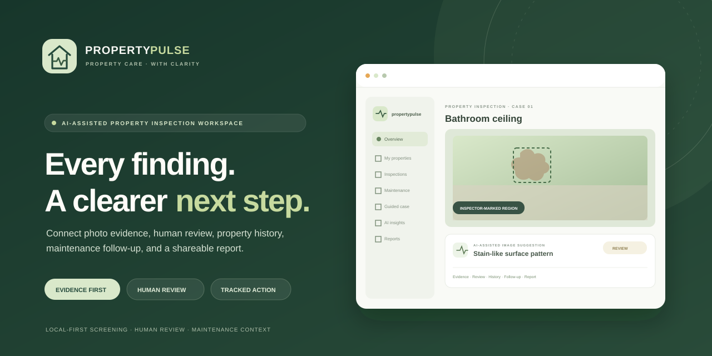

# PropertyPulse AI

**An evidence-led inspection and maintenance workspace for homeowners and property managers.** PropertyPulse connects a property photo to a human-reviewed observation, a transparent maintenance recommendation, the property's history, a practical follow-up task, and a shareable report.

> **Model and safety note:** PropertyPulse is a screening and record-keeping aid. Its image model is an experimental image-level classifier; it is not calibrated for real-world diagnosis, does not locate a defect, and cannot determine structural safety or cause. A qualified person must review observations and decide what action is appropriate.

## Why this project

Property inspections often leave photos, notes, historical context, decisions, and follow-up tasks scattered across separate tools. PropertyPulse brings these steps into one inspectable workflow so the next person can see what was photographed, what the model suggested, what a human confirmed, what context informed the priority, and what follow-up was planned.

For the complete product definition, implementation map, acceptance criteria, risks, and scale-up roadmap, see the [Product and Delivery Blueprint](docs/PRODUCT_BLUEPRINT.md).

The supplied hackathon screenshot identifies NEURA X 2026 / PropCare NW and shows a final submission stage requesting an AI project, GitHub repository, demo video, and working demo. The exact official problem-statement wording was not available in the supplied material, so the project maps to the property-care problem at a concept level without inventing challenge criteria. Add the official statement and judging rubric here when available.

## Product walkthrough

The **Guided case** demonstrates all five feature areas in one connected, persistent workflow:

1. **Screen evidence:** choose an explicitly labelled dataset example or upload a real JPG, PNG, or WebP photo. The local classifier proposes an image-level label and model score.
2. **Review and triage:** compare the model suggestion with the photo, confirm/correct/dismiss it, add a note, and inspect the plain-language priority reasons. A reviewer can record a priority override and why.
3. **Compare history:** view earlier and current records for the same demo property area. A person records the trend; the UI explains when photos are dataset illustrations and not photographs of the same physical defect.
4. **Plan follow-up:** create a persisted task linked to the property, inspection, and finding. Set an owner and due date, then move it through open, in-progress, blocked, and completed.
5. **Share the record:** generate and download a PDF with image evidence, model/version details, human review, priority reasons, comparisons, and linked follow-up.

The seeded walkthrough is named **Willow Court · Unit 204**. It is fictional. Its earlier image is an illustrative dataset sample, not a photograph of that property. The seed/reset endpoints only operate on this labelled demo case and do not clear the user's other properties.

## Feature set

| Capability | What it does | Trust boundary |
|---|---|---|
| Property portfolio and inspections | Create and manage properties, dated area inspections, notes, and context | Each record belongs to the authenticated account |
| Image screening | Upload photos or choose a dataset example; run the local seven-label classifier | The score is a model score, not a calibrated probability or diagnosis |
| Human review and audit trail | Confirm, correct, dismiss, annotate a region, and keep a review history | Inspector-marked regions are not AI localization |
| Explainable maintenance triage | Show priority, reasons, next action, and justified human override | Triage is distinct from image classification |
| Property history and trends | Compare reviewed records from the same property area | Trend state is inspector-attributed, never inferred from repeated labels alone |
| Maintenance queue | Persist tasks, owners, due dates, priorities, linked findings, and statuses | Tasks organize follow-up; they are not repair instructions |
| PDF reports | Produce a downloadable evidence and decision record | The report states model and professional-review limitations |
| Dashboard and insights | Summarize the user's portfolio, inspections, and recorded observations | Summaries are derived from saved records |
| Interactive room map | Select a room hotspot and open a real inspection form prefilled with that area | The isometric room is an illustration, not a scan of the user's property |

## Connected case flow

~~~mermaid
flowchart LR
  A[Property and area] --> B[Inspection context]
  B --> C[Photo upload or labelled sample]
  C --> D[Image-level model suggestion]
  D --> E[Human review and saved decision]
  E --> F[Explainable priority and next action]
  F --> G[Human-recorded history comparison]
  G --> H[Linked maintenance task]
  H --> I[Evidence-rich PDF report]
  E -. review event .-> J[(Audit history)]
  H -. persisted workflow .-> K[(Task records)]
~~~

## Architecture

~~~mermaid
flowchart TB
  Browser[React 19 and TypeScript UI]
  API[FastAPI JSON API]
  Auth[Bearer token and account ownership]
  DB[(SQLAlchemy database
SQLite by default)]
  Files[(Local image and report storage)]
  Model[HOG feature extraction
SGDClassifier]
  Rules[Versioned triage rules]
  PDF[ReportLab PDF builder]

  Browser -->|JSON and multipart upload| API
  API --> Auth
  Auth --> DB
  API --> DB
  API --> Files
  API --> Model
  API --> Rules
  API --> PDF
  PDF --> Files
~~~

### Main data relationships

~~~mermaid
erDiagram
  USER ||--o{ PROPERTY : owns
  PROPERTY ||--o{ INSPECTION : contains
  INSPECTION ||--o{ INSPECTION_IMAGE : records
  INSPECTION_IMAGE ||--o{ FINDING : produces
  PROPERTY ||--o{ MAINTENANCE_TASK : tracks
  INSPECTION ||--o{ REPORT : summarizes
  FINDING ||--o{ FINDING_REVIEW_EVENT : audits
  USER ||--o{ FINDING_REVIEW_EVENT : records
  FINDING ||--o{ ISSUE_TREND : "previous or current"
  USER ||--o{ ISSUE_TREND : attributes
  FINDING ||--o{ MAINTENANCE_TASK : links

  USER {
    int id PK
    string email
    string name
  }
  PROPERTY {
    int id PK
    int owner_id FK
    string name
    boolean is_demo
  }
  INSPECTION {
    int id PK
    int property_id FK
    string area_label
    json context_flags
  }
  INSPECTION_IMAGE {
    int id PK
    int inspection_id FK
    string storage_key
    string sha256
    boolean is_sample
  }
  FINDING {
    int id PK
    int image_id FK
    string source_label
    float confidence
    string status
    string origin
  }
  FINDING_REVIEW_EVENT {
    int id PK
    int finding_id FK
    int user_id FK
    string previous_status
    string next_status
  }
  ISSUE_TREND {
    int id PK
    int previous_finding_id FK
    int current_finding_id FK
    string trend_state
    string attribution
  }
  MAINTENANCE_TASK {
    int id PK
    int property_id FK
    int finding_id FK
    date due_date
    string status
  }
  REPORT {
    int id PK
    int inspection_id FK
    string content_hash
  }
~~~

## Machine-learning transparency

The current local baseline uses grayscale 128 × 128 pixels, Histogram of Oriented Gradients (HOG) features, and a class-balanced SGD classifier trained with log loss. Its seven labels are algae, major crack, minor crack, peeling, plain, spalling, and stain.

| Recorded holdout metric | Baseline |
|---|---:|
| Dataset rows used | 3,172 |
| Stratified holdout rows | 635 |
| Accuracy | 43.62% |
| Macro F1 | 42.54% |
| Model version | bd3-hog-sgd-2026-10-31 |
| Split seed | 42 |

These figures come from the local model metadata generated by the training script. They describe one split of the cited dataset and do not predict performance on new properties, materials, cameras, or lighting. Individual model scores are not calibrated probabilities. A score under 0.48 is routed to human review. The classifier is image-level: it cannot draw a defect boundary, measure size, establish cause, price a repair, or certify safety. Region marks are created by the inspector.

Training metrics and class-wise results are recorded in the generated, git-ignored file backend/models/model_info.json. A confusion matrix is produced when training runs. The saved artifact and metrics are intentionally not claimed as improvements without a measured evaluation.

Dataset and sample-image credit: [chandrabhuma/building_defect_vqa](https://huggingface.co/datasets/chandrabhuma/building_defect_vqa), listed as CC BY 4.0, with source/research context in [BD3 Dataset](https://github.com/Praveenkottari/BD3-Dataset). Attribution and reuse notes: [backend/DATA_SOURCES.md](backend/DATA_SOURCES.md).

## Design system and brand assets

The interface uses a quiet, editorial property-care style with larger Manrope headings, legible DM Sans body text, roomier cards, high-contrast green actions, clear statuses, and responsive layouts. The dashboard's code-drawn isometric room has selectable hotspots that open the actual inspection form with the selected area prefilled; it is an illustration, not a property scan.

| Token or role | Color |
|---|---|
| Main canvas | #F6F7F3 |
| Surface | #FFFFFF |
| Primary ink | #24372D |
| Primary action | #355C45 |
| Sage accent | #8AA37C |
| Soft sage surface | #EDF3E9 |
| Warm status accent | #C8906D |

Included assets:

- frontend/public/propertypulse-mark.svg — primary light-background wordmark symbol
- frontend/public/propertypulse-mark-dark.svg — dark-background mark variant
- frontend/public/favicon.svg — browser favicon
- frontend/public/propertypulse-icon.png — 1024 px app icon
- frontend/public/apple-touch-icon.png — Apple touch icon
- frontend/public/social-preview.svg and docs/assets/social-preview.svg — social preview and project thumbnail illustration
- frontend/public/icons.svg — icon sprite
- scripts/render_brand_icons.py — deterministic standard-library icon rasterizer

The social preview is a branded product illustration, not a screenshot of a running interface. The application loads its fonts from local npm packages. The icon source and color values live alongside the frontend; see frontend/src/App.css and frontend/src/components/WorkspaceFeatures.css.

## Technology

| Layer | Stack |
|---|---|
| Web application | React 19, TypeScript, Vite 8 |
| UI and charts | Framer Motion, Lucide, Recharts, DM Sans, Manrope |
| API | FastAPI, Uvicorn, Pydantic |
| Persistence | SQLAlchemy, SQLite by default; DATABASE_URL can point at another SQLAlchemy-supported database |
| Image pipeline | Pillow validation/re-encoding, scikit-image HOG, scikit-learn, joblib |
| Reports | ReportLab |
| Training data | Hugging Face datasets |

## Run locally

### Prerequisites

- Python 3.11 or newer
- Node.js 20.19+ or 22.12+
- Network access for first-time model training, which downloads the dataset
- Windows PowerShell examples are below; the commands can be adapted for macOS/Linux

### 1. Create the backend environment and install dependencies

Run from the project root:

~~~powershell
python -m venv .venv
.\.venv\Scripts\Activate.ps1
python -m pip install --upgrade pip
python -m pip install -r backend\requirements.txt
~~~

### 2. Train the local demo classifier

The trained model artifact is generated and git-ignored. CC BY 4.0 dataset samples are included under backend/samples for the demo library; training regenerates them if missing. Train once to create the classifier artifact:

~~~powershell
python backend\train_classifier.py
~~~

Training downloads the attributed dataset, computes deterministic image features, makes a stratified 80/20 split using seed 42, saves the model under backend/models, and writes first-per-class demonstration images under backend/samples.

### 3. Start the API

From the project root, in terminal one:

~~~powershell
python -m uvicorn backend.app.main:app --reload --port 8100
~~~

Check API health at http://localhost:8100/health. Interactive API docs are at http://localhost:8100/docs.

### 4. Start the frontend

In terminal two:

~~~powershell
cd frontend
npm install
npm run dev
~~~

Open the Vite URL printed in the terminal (normally http://localhost:5173). The Vite configuration uses the frontend defaults; set VITE_API_BASE in frontend/.env.local if the API is hosted somewhere other than http://localhost:8100.

The app opens in the local demo workspace. Use the **Guided case** navigation item to open the five-step walkthrough. Demo seeding is idempotent for the current account.

### Environment configuration

Copy backend/.env.example to backend/.env and replace the development secret before exposing the API beyond localhost. Relevant settings:

| Variable | Default | Purpose |
|---|---|---|
| PROPERTY_PULSE_SECRET | local development fallback | Signing secret for local bearer tokens; replace with a long random value |
| PROPERTY_PULSE_TOKEN_HOURS | 168 | Token lifetime |
| PROPERTY_PULSE_CORS | localhost frontend origins | Allowed browser origins |
| DATABASE_URL | SQLite file under backend/data | Optional SQLAlchemy connection string |
| PROPERTY_PULSE_DATA_DIR | backend/data | Database-adjacent report and application data |
| PROPERTY_PULSE_UPLOAD_DIR | backend/uploads | Stored, processed inspection images |
| PROPERTY_PULSE_MODEL_DIR | backend/models | Local classifier artifacts and metadata |
| VITE_API_BASE | http://localhost:8100 | Frontend API base URL, set in frontend/.env.local |

Keep secrets out of version control. Local SQLite, uploads, generated model artifacts, and Python environments are ignored by git. Back up the database and files together if you need to preserve a workspace.

## API reference

Workspace routes require a bearer access token. Demo, registration, and login endpoints issue tokens; /health is public; model metadata requires authentication. Image responses use one-hour signed media URLs, and stored inspection-image retrieval also checks the owning account. The bundled demo login is designed for a local showcase and is not production authentication.

| Area | Method and route | Purpose |
|---|---|---|
| Health | GET /health | Liveness, model status, and saved metrics |
| Model | GET /api/v1/model | Authenticated model readiness/version disclosure |
| Authentication | POST /api/v1/auth/demo | Open the local demo account |
| Authentication | POST /api/v1/auth/register, POST /api/v1/auth/login | Create or access an account |
| Profile | GET/PATCH /api/v1/auth/me | Read/update account profile |
| Dashboard | GET /api/v1/dashboard | Account-scoped portfolio and activity summary |
| Properties | GET/POST /api/v1/properties | List or create a property |
| Properties | GET/PATCH/DELETE /api/v1/properties/{property_id} | Read, update, or delete an owned property |
| Inspections | POST /api/v1/properties/{property_id}/inspections | Create an inspection |
| Inspections | GET /api/v1/inspections/{inspection_id}; GET /api/v1/properties/{property_id}/history | Open inspection or property timeline |
| Samples | GET /api/v1/demo/samples | List available labelled example images |
| Guided case | POST /api/v1/demo/case/seed; DELETE /api/v1/demo/case | Idempotently load or reset only the seeded showcase case |
| Media | GET /api/v1/media/{media_token} | Retrieve an image with a signed, expiring URL; inspection media is checked against its owner |
| Images | POST /api/v1/inspections/{inspection_id}/images | Validate and store an uploaded image |
| Images | POST /api/v1/inspections/{inspection_id}/samples/{sample_id} | Add a labelled dataset example |
| Analysis | POST /api/v1/images/{image_id}/analyze | Run local image-level classification and create a finding |
| Annotation | POST /api/v1/images/{image_id}/annotations; PUT /api/v1/findings/{finding_id}/region | Save inspector annotation/region |
| Finding review | PATCH /api/v1/findings/{finding_id}; GET /api/v1/findings/{finding_id}/reviews | Save human decision and retrieve review events |
| Tasks | GET/POST /api/v1/tasks; PATCH /api/v1/tasks/{task_id} | List/filter, create, and update maintenance tasks |
| Trends | GET /api/v1/properties/{property_id}/trends; POST /api/v1/findings/{finding_id}/trends | Read or record inspector-attributed comparisons |
| Reports | POST /api/v1/inspections/{inspection_id}/reports; GET /api/v1/reports/{report_id}/download | Generate and download a PDF inspection record |

Interactive request/response schemas are exposed by the FastAPI docs at /docs.

## Repository map

~~~text
PropertyPulse AI/
├── backend/
│   ├── app/                 # API, SQLAlchemy models, schemas, triage rules, migration helper
│   ├── data/                # local database and PDF report files (generated, ignored)
│   ├── models/              # local model and evaluation metadata (generated, ignored)
│   ├── samples/             # local demonstration images (generated from the dataset)
│   ├── uploads/             # processed user images (local and ignored)
│   ├── DATA_SOURCES.md      # dataset attribution and sample-image reuse notes
│   └── train_classifier.py  # reproducible baseline trainer
├── docs/
│   ├── PRODUCT_BLUEPRINT.md
│   └── assets/social-preview.svg
├── frontend/
│   ├── public/              # favicon, marks, icon, and social preview
│   └── src/                 # application pages, 3D room scene, guided case, maintenance, API client
├── scripts/
│   └── render_brand_icons.py
├── PropertyPulse_AI_5_Feature_Build_Prompt.md
└── README.md
~~~

## Privacy and operational limits

- Image processing is local to the API in this build. Inspection images are delivered through one-hour signed URLs and the API checks record ownership. Protect the signing secret, and use private object storage with short-lived signed access when deploying beyond a local showcase.
- Authenticated routes scope properties, inspections, findings, tasks, trends, and reports to the current account.
- The demo flow uses a shared demo identity on a local database. It is only suitable for a local walkthrough, not multi-tenant public use.
- Upload handling validates image type and size and re-encodes supported images; configure storage, backup, retention, and deletion policies for production.
- No background worker or mobile offline-sync layer is included.
- No AI-generated localization, repair-cost estimate, moisture-cause inference, structural-risk score, or guarantee is offered.

## Roadmap: MVP to full-scale product

1. **Pilot readiness:** collect consented and representative local property images; define labeling guidance; evaluate by property/material/capture conditions; calibrate model confidence; compare performance with qualified inspectors.
2. **Capture workflow:** mobile-first camera coaching, offline inspection drafts, sync conflict handling, voice notes, reusable room templates, and accessibility testing on devices in the field.
3. **Team operations:** organization and property membership, roles, invitations, assignment history, notifications, contractor/vendor access, and immutable audit events.
4. **Maintenance lifecycle:** recurring plans, quotes and invoices, vendor scheduling, approvals, expenses, completion evidence, reminders, and integrations with property-management systems.
5. **Production platform:** managed Postgres, private object storage, background image jobs, model registry and rollback, monitoring, drift review, backups, observability, rate limiting, and deployment automation.
6. **Responsible AI expansion:** only add segmentation or measurements after obtaining suitable annotated images, establishing evaluation protocols, validating on representative data, and making human review visible.

Every phase should retain evidence provenance, informed consent, deletion/export controls, plain-language recommendations, and professional oversight.

## Hackathon demo checklist

- Start the API and frontend; open the working local demo.
- Walk the judges through the seeded case from screening through PDF report.
- Explain that the past/current sample images are illustrative dataset examples rather than the same real property photographs.
- Show where a person confirms or corrects an image-level suggestion, records a trend, and owns the follow-up.
- Show model evaluation and limitations instead of describing the score as real-world accuracy.
- Submit the repository and working demo; prepare the demo video and any required event-specific form fields using the official event page.
- Check the official event page for the final deadline and exact judging criteria before submission; do not infer them from the screenshot alone.

## Project status

This is a locally runnable hackathon product build. The UI and API support the documented flows; a production deployment still needs the roadmap items above. The repository's project code is covered by the MIT license in LICENSE. Dataset images retain their separate CC BY 4.0 attribution requirements; third-party dependencies keep their own licenses.

## Safety boundary

PropertyPulse organizes visible observations for routine maintenance review. It is not an emergency assessment, engineering inspection, insurance determination, valuation, or substitute for a qualified on-site professional. If a condition may present an immediate hazard, follow local emergency procedures and contact an appropriately qualified professional.
